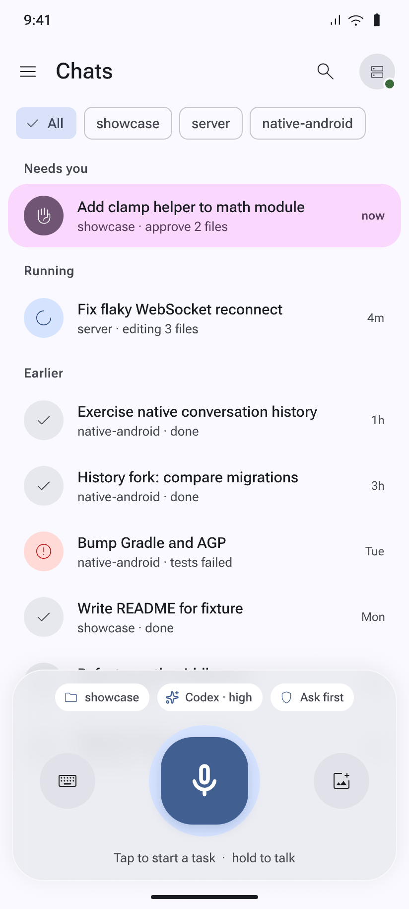
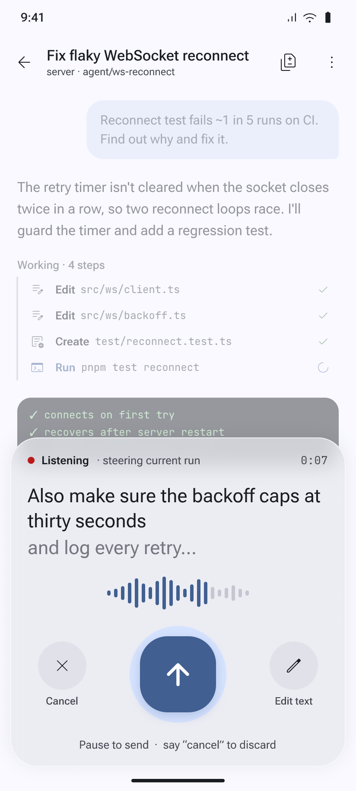
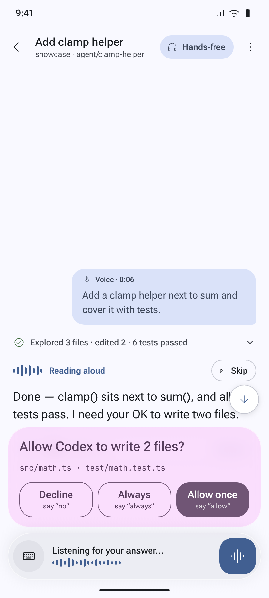
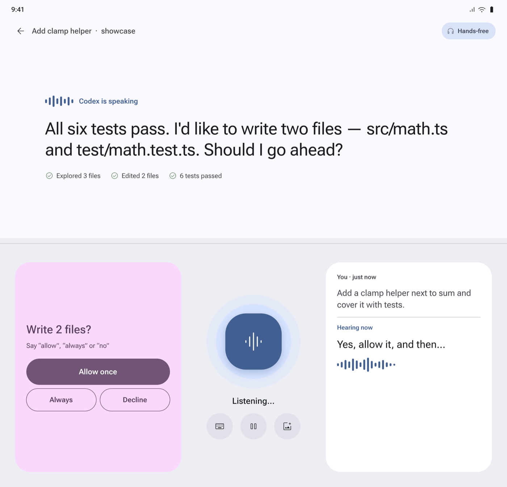
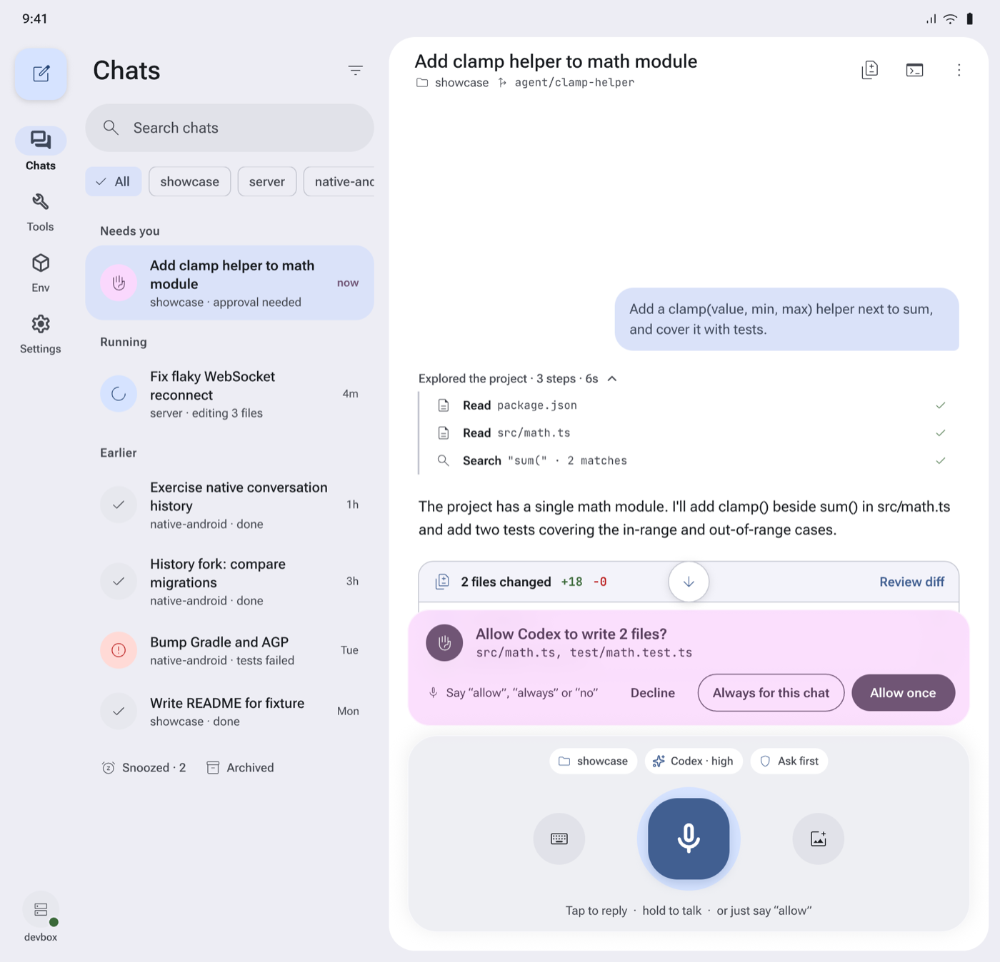

# Teethree

A native Android version of [T3 Code](https://github.com/pingdotgg/t3code), rebuilt in
Kotlin and Jetpack Compose around a voice-first interface.

T3 Code is Theo Browne's minimal GUI for coding agents, built by Theo and the T3 Tools
team. Everything that makes it work, from the agent orchestration to the environments you
connect to, comes from their project. Teethree only replaces the phone app: it connects to
the same T3 Code environment on your desktop or server, so you can follow your coding
agents, answer them, and start new tasks from your phone, mostly by talking to it.

<p align="center">
  
  
  
</p>

## What it does

- **Conversations.** Browse chats grouped by what needs you, what's running and what's
  done. Read agent replies with Markdown and math, and reply to or steer a running agent.
- **Approvals and questions.** Answer an agent's questions and approve or decline its
  actions inline in the chat.
- **Voice first.** Tap to talk, hold for push-to-talk, or go hands-free and have replies
  read aloud. On Android 14 and newer it uses Google's speech service, the engine behind
  Gboard's voice typing.
- **Works while connecting.** The app opens on the screen you left, from a saved copy, and
  reconnects in the background. Messages, approvals and answers you give meanwhile are
  sent once connected. A quiet status line under the title shows the connection; help
  appears only if the desktop can't be reached for 30 seconds.
- **New tasks.** Pick a project, model and access mode, and start a task with text, voice,
  files or shared content from other apps.
- **Tools.** A terminal (Ghostty), browser and device previews, pull request review, and
  project settings.
- **Awareness.** Push notifications when an agent needs you, and a home-screen widget for
  subscription usage.
- **Adaptive layouts.** Phone, tablet and foldable layouts, including a tabletop voice
  console on a half-folded phone.
- **Several environments.** Pair with multiple T3 Code environments, directly over the
  local network or through T3 Connect.

## On foldables

<p align="center">
  
  
</p>

Screens are renders from the app's design file, with demo content.

## Requirements

- Android 12 (API 31) or newer. Android 17 asks for local-network access when you connect
  to an environment on your local network.
- A running T3 Code environment to pair with, using that environment's pairing link.

## Build

You need JDK 25, Android SDK 37, NDK `28.2.13676358` and CMake `3.22.1`. Android Studio's
SDK Manager provides the SDK, NDK and CMake. Gradle's daemon toolchain criteria and the
Foojay resolver download JDK 25 if it isn't installed. Gradle itself still needs a JDK to
start: set `JAVA_HOME` (Android Studio's bundled JDK works) and `ANDROID_HOME`, or set the
SDK path in `local.properties`. You can also open this directory in Android Studio.

```sh
./gradlew :app:assembleDebug                      # build the debug APK
./gradlew :app:installDebug                       # build and install on a connected device
./gradlew :app:testDebugUnitTest :app:lintDebug   # unit tests and lint
./gradlew :app:connectedDebugAndroidTest          # Compose UI tests on a device
```

The debug APK is written to `app/build/outputs/apk/debug/app-debug.apk`.
`:app:assembleRelease` builds an optimized APK signed with the debug key, so it installs
over a debug build without losing data. Use a real signing key before publishing it.

Material 3 is pinned to `1.5.0-rc01`, ahead of the Compose BOM, for the Expressive
components such as the wavy progress indicator. See `gradle/libs.versions.toml`.

## Configuration

**Application ID.** The app uses T3 Code's Android development package,
`com.t3tools.t3code.dev`, so it installs alongside the published T3 Code app.

**Sign-in (T3 Connect).** Sign-in uses Clerk. Email-code sign-in works entirely inside the
app; use the email already attached to your T3 account. OAuth sign-in returns through
`clerk://com.t3tools.t3code.dev.callback`, which the selected Clerk instance must allow.
The default public key points at T3's hosted instance, and you can't change its callback
allowlist.

**Push notifications.** Set the `T3CODE_ANDROID_GOOGLE_SERVICES_FILE` environment variable
or Gradle property to a Firebase Android configuration file whose client matches
`com.t3tools.t3code.dev`, or place it at `app/google-services.json`, which git ignores.
Without it the app builds normally, but push delivery stays off. Device tokens are created
at runtime; Firebase server credentials belong to the relay deployment.

## Project layout

```
app/src/main/java/com/example/teethree/
  data/        connection, RPC client, repository and tool integrations
  ui/          Compose screens, composer, voice input and theme
  awareness/   notifications and the usage widget
third_party/
  ghostty/     terminal runtime, JNI bridge and fonts
  t3code/      upstream license for ported T3 Code sources
```

## Credits

[T3 Code](https://github.com/pingdotgg/t3code) is created by Theo Browne and T3 Tools. This
app wouldn't exist without it: the protocol, the environments, the agent workflow and much
of the ported client logic are theirs. Thank you, Theo and team, for building it and
releasing it under the MIT license. If you like what Teethree does, go star the original.

Teethree adds the native Android shell and its voice-first interface on top. Problems you
hit in this app are likely ours, not T3 Code's, so please report them here.

## License

Teethree is released under the [MIT License](LICENSE), the same license as T3 Code, kept
as it appears in the original repository (© T3 Tools Inc.). A copy of the upstream notice
also stays with the ported sources in `third_party/t3code/LICENSE`.

The terminal runtime and fonts have their own licenses and provenance, recorded in
`third_party/ghostty`.
